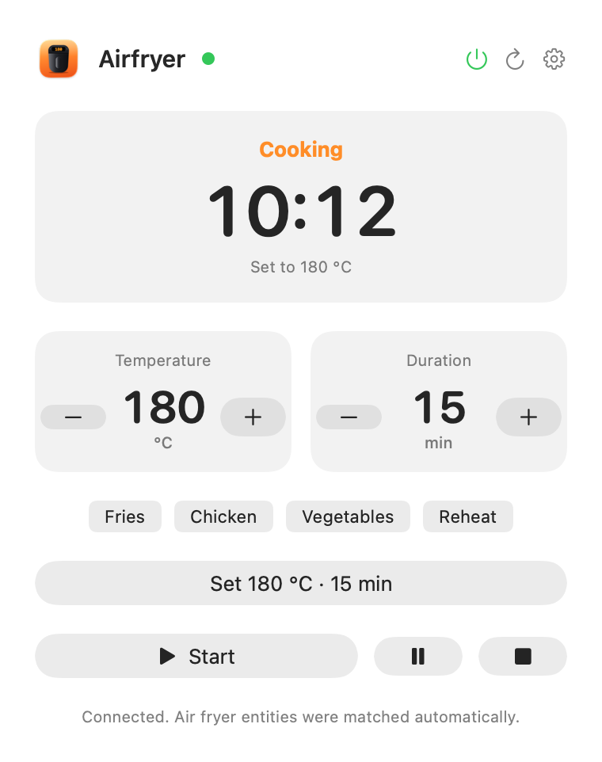

# Airfryer Mac

A small native macOS app (menu bar + window) to control a **Philips Airfryer 5000 Series Connected** from your Mac: set temperature and time, start, pause, stop, turn it on and off, and get a notification when cooking is done.

> **Unofficial project.** Not affiliated with, endorsed by or sponsored by Philips or Versuni. *Philips*, *Airfryer*, *HomeID* and *NutriU* are trademarks of their respective owners. This repository does not include any Philips logo or product image.

> **Safety.** An air fryer is a heating appliance. Never leave it running unattended, and do not rely on this app as a safety device. The software is provided "as is" (see [LICENSE](LICENSE)).

[Italiano](README.it.md)

<p align="center"><picture>
  <source media="(prefers-color-scheme: dark)" srcset="docs/screenshot-en-dark.png">
  
</picture></p>

## How it works

The app does not talk to the air fryer directly. It uses [Home Assistant](https://www.home-assistant.io/) and the community integration [Philips HomeID](https://github.com/renaudallard/homeassistant_philips_homeid):

```
Airfryer Mac  ──REST──▶  Home Assistant  ──▶  Philips HomeID integration  ──▶  air fryer
 (this app)               (local, Docker)       (local network or Philips cloud)
```

Recent firmware (e.g. **4.0.0 / 0.6.8** on the HD9255) is cloud-only: commands go through the Philips cloud and need an internet connection and your HomeID account. Older firmware may be controllable locally; this is handled by the integration, not by this app.

## Features

- Temperature and duration with +/− controls limited to the ranges reported by the appliance, plus quick programs (fries, chicken, vegetables, reheat).
- Start (with a confirmation), pause, stop, and a power button.
- Live status, remaining time (also in the menu bar while cooking) and an end-of-cooking notification.
- Automatic matching of the air fryer entities, with manual override.
- Menu bar icon and a regular window with a Dock icon (useful when the notch hides menu bar icons).
- Optional custom header picture (for example a photo of your own appliance), stored only on your Mac.
- Translated into 29 languages, following the system language.

## Requirements

- Apple Silicon Mac, macOS 14 or later.
- Xcode Command Line Tools (to build from source): `xcode-select --install`. If the build says the tools are out of date for your macOS, update them from System Settings → General → Software Update.
- A Home Assistant instance (2025.3 or later) with the Philips HomeID integration and your air fryer paired in the official Philips app first.
- Docker Desktop, if you want to run Home Assistant on the same Mac with the provided compose file.

## Install

Build from source:

```bash
git clone https://github.com/<your-username>/airfryer-mac.git
cd airfryer-mac
./Installa.command        # or: bash Tools/build.sh
```

The app is created in `build/Airfryer Mac.app`; drag it to Applications. Release archives are ad-hoc signed and **not notarized**: on first launch, right-click the app and choose Open.

## Setup

1. **Home Assistant.** `cd homeassistant && docker compose up -d`, then open <http://localhost:8123> and create your user. Skip this if you already have Home Assistant.
2. **Integration.** Install *Philips HomeID* with HACS, or copy `custom_components/philips_homeid` from its repository into `homeassistant/config/custom_components/` and restart Home Assistant. Add it under Settings → Devices & services and log in with the email of your HomeID account (a one-time code is sent to you).
3. **Token.** In Home Assistant open your profile → Security → *Long-lived access tokens* → Create token. Copy it right away and never share it.
4. **App.** Open Airfryer Mac, enter the Home Assistant address (for example `http://localhost:8123`) and paste the token in Settings, then *Save and connect*. The seven entities are matched automatically; check them under *Associated entities*.

## Security and privacy

- The token is stored in the macOS Keychain, bound to the server address. Revoke it in Home Assistant at any time.
- Over plain HTTP the token travels unencrypted: use it only on a trusted network, or use HTTPS.
- The app does not follow redirects, does not accept invalid TLS certificates and sends no telemetry. It only talks to the Home Assistant address you configure.
- `homeassistant/config/` contains your database, logs and access tokens: it is git-ignored, never commit it.

## Development

```bash
bash Tests/run.sh                          # logic tests against a fake Home Assistant
python3 Tools/l10n/generate.py             # validate translations and regenerate Resources/*.lproj
python3 Tools/l10n/check_code.py           # every UI string in the code has a key
swiftc -O Tools/make_icon.swift -o build/make_icon && build/make_icon build/icon   # app and menu bar icons
bash Tools/make_release.sh                 # dist/AirfryerMac-<version>.zip
```

Layout: `Sources/Core.swift` (Home Assistant client, entity matching, validation), `Sources/App.swift` (SwiftUI interface), `Tests/` (tests and fake Home Assistant), `Tools/` (build, release, icon, localization), `Resources/` (icons and `*.lproj`), `homeassistant/` (compose file).

### Translations

Keys are the English strings in the code; translations live in `Tools/l10n/lang_*.py`. They were written with an AI model and **have not been reviewed by native speakers**: corrections are very welcome as pull requests. To add a language, add a list with the same strings in the same order, then run `generate.py`.

## Status and limitations

- Developed against one Philips Airfryer 5000 Series (HD9255, firmware 4.0.0 / 0.6.8). Other models and firmware versions are untested.
- Verified on that unit: connection, automatic entity matching and power on/off. Set values, start, pause and stop are implemented through the integration's entities and covered by tests against a fake server; confirm them on your appliance before relying on them.
- Success means Home Assistant received the command, not that the appliance executed it: always check the appliance.
- Not notarized; no automatic updates.
- Screenshots are generated with sample data: `Airfryer Mac --screenshot <folder> <suffix>`.

## License

Airfryer Mac is free software, released under the [GNU General Public License v3.0 or later](LICENSE) (GPL-3.0-or-later): you can use, study, share and modify it, and any distributed modified version must remain under the same license with its source available. The Philips HomeID integration is a separate project with its own license and is not included here.
